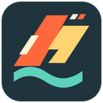
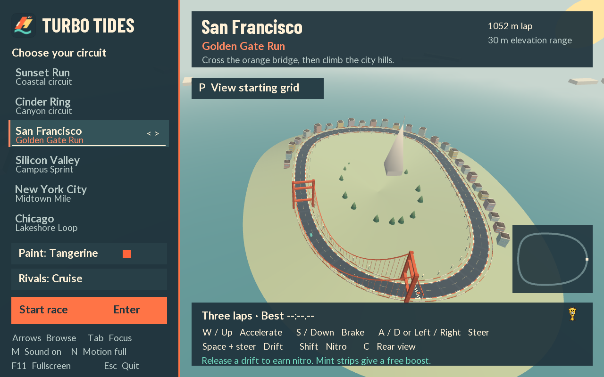
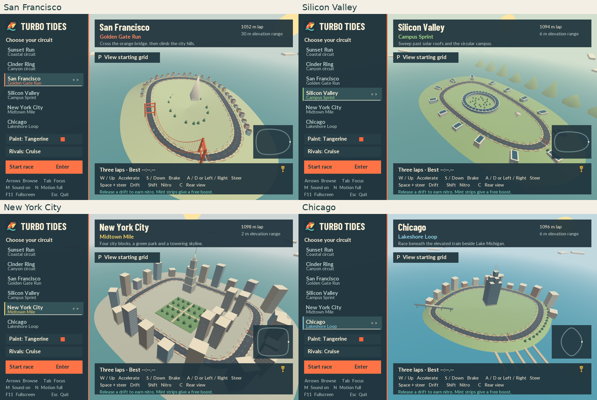

# Turbo Tides



A colourful **3D arcade racer written in Kotlin**. Race five friends through
six coastal and city circuits, drift to charge nitro, hit turbo pads, and chase a
three-lap personal best. Made from the [Phippy Gaming Workshop](https://github.com/Tingsters/Phippy-Gaming-Workshop)
prompt, with the workshop's Phippy pit crew artwork.



## Play the app

Get the [latest Linux download](https://github.com/samsaw123456/turbo-tides/releases/latest).

On the computer where it is installed, open **Turbo Tides** from the application
menu. The Linux app includes its own Java runtime and works offline.

For a portable download, extract `turbo-tides-1.1.0-linux-x86_64.tar.gz`, open the
`TurboTides` folder, and run **Play Turbo Tides**. Requires a Linux x86-64 desktop
with OpenGL 2.0 support, glibc, and X11 or XWayland. No account is needed.

Choose a circuit, one of five paint colours, and **Cruise** or **Race** rival pace.
Click a named route or browse with Left/Right to preview its actual 3D scene.
Press **P** to switch between the whole circuit and your car on the starting grid.
Choosing a paint colour also shows the car. Tab moves between menu controls;
Shift+Tab moves back. Up/Down moves the selection, and Enter starts the focused
route or activates the focused setting.

| Circuit | What to look for |
| --- | --- |
| Sunset Run | Palm-lined ocean bends |
| Cinder Ring | Red-rock climbs and tight corners |
| San Francisco — Golden Gate Run | Suspension bridge, steep hills and pastel houses |
| Silicon Valley — Campus Sprint | Circular campus, solar roofs and broad bends |
| New York City — Midtown Mile | Skyscrapers, yellow taxis and a park |
| Chicago — Lakeshore Loop | Twin-antenna skyline, elevated train and lakefront |

The city tracks are playful fictional routes inspired by their locations.



Press Enter to race. Finish three laps; your best race time is saved separately
for each circuit and difficulty. A slower finish still completes the race, and
you can immediately retry. Drifting charges nitro when you release Space.

| Key | Action |
| --- | --- |
| W / Up | Accelerate |
| S / Down | Brake |
| A, D / Left, Right | Steer |
| Space + steer | Drift; release to bank nitro |
| Either Shift | Use nitro |
| C | Look behind |
| Esc | Pause/resume; back to garage after finishing |
| R | Restart race |
| M | Mute/unmute all sound |
| N | Reduce camera motion and disable boost zoom |
| F11 | Toggle fullscreen |
| P (menu) | Toggle whole-circuit / starting-grid preview |

Menus support mouse, arrow keys, Tab and Enter. The game pauses when its window
loses focus. Boost strips are mint coloured. Grass slows the car, and barriers
keep the route recoverable. There is no reverse gear. Your car turns with the
road; steering controls your racing line.
While holding C, the camera looks backwards and steering remains relative to
the car's forward direction, so left/right appear mirrored in that rear view.
Release C to return immediately to the forward chase camera.

## Build and develop

Requires JDK 17 or later. The checked-in Gradle wrapper downloads its pinned
Gradle distribution and verifies its checksum. Kotlin, libGDX, and other build
dependencies are fetched on the first build; the built game needs no network.
Run the development commands below in a source checkout.

```sh
./gradlew run                   # run from source
./gradlew check fatJar          # Kotlin lint, regression tests, executable JAR
./gradlew ktlintFormat          # format Kotlin
python3 -m unittest discover -s tools -p 'test_*.py'
ruff check tools && ruff format --check tools
python3 tools/package_linux.py --install
```

The packager needs a complete JDK with `jpackage` and desktop modules in `jmods`.
It creates a portable app with a bundled
runtime and, with `--install`, a per-user application-menu entry. Set
`TURBO_JAVA_HOME` to select a packaging JDK. A project launcher, `turbo-tides`,
and a **Play Turbo Tides** task for Zed are also included. Rebuild/package after
source edits to refresh these launchers' packaged app.

Rendering, input and audio use libGDX/LWJGL3. The game rules and tracks are plain
Kotlin, tested independently at fixed 120 Hz. See [design and checklist](docs/DESIGN.md)
and [verification](docs/PLAYTEST.md), including the [complete control audit](docs/CONTROLS.md).
All scenery, cars, sound and the SVG logo
are original code-generated assets; imported artwork and fonts are credited in
[THIRD_PARTY.md](THIRD_PARTY.md).

The native application has been tested on Linux. The executable JAR includes
Windows and macOS libraries, but those systems have not been tested. macOS Java
launches require `-XstartOnFirstThread`. This release does not include an Android
APK, touch controls or controller support.

Preferences and records use libGDX's `turbo-tides` preferences file under
`~/.prefs/`. An opt-in `--telemetry PATH` mode writes diagnostics for native
playtests and uses separate `turbo-tides-playtest` preferences. Nothing is sent
over the network.

The city update includes screen-space steering regressions and a native-input
audit in `tools/city_playtest.py`: `menu`, `mechanics`, and `circuits` scenarios.
It reads optional diagnostic output and drives the real window with native input
events (XTest, with an X11 pointer-event fallback for XWayland).
`tools/control_audit.py` checks every binding and captures rendered frames and
game-only audio; `--holds-only` checks held shortcuts and menu key repeat.
`--presentation-only` captures coast, drift-release and rear-camera transitions;
`--states-only` finishes a race and checks individual disabled bindings and
menu focus in each state. `--focus-only` verifies release of every driving key
while unfocused, including latent modifier recovery. See the verification
document for required tools and environment options.
